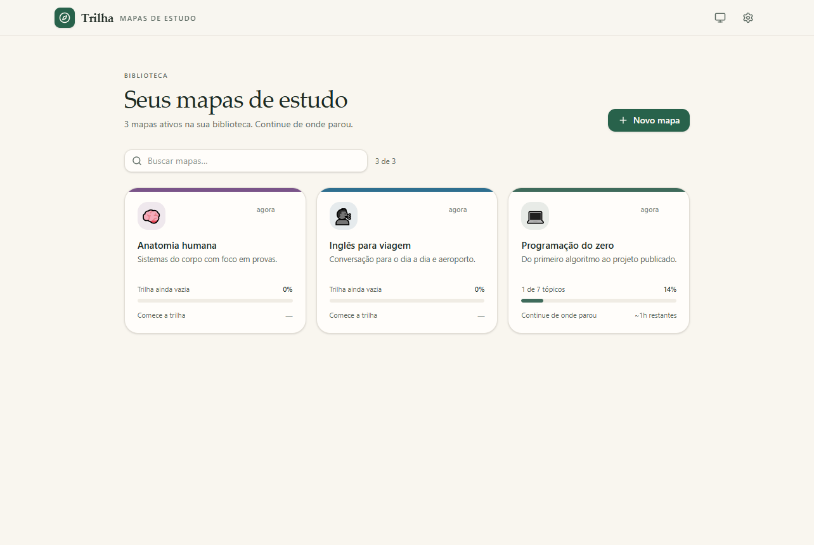
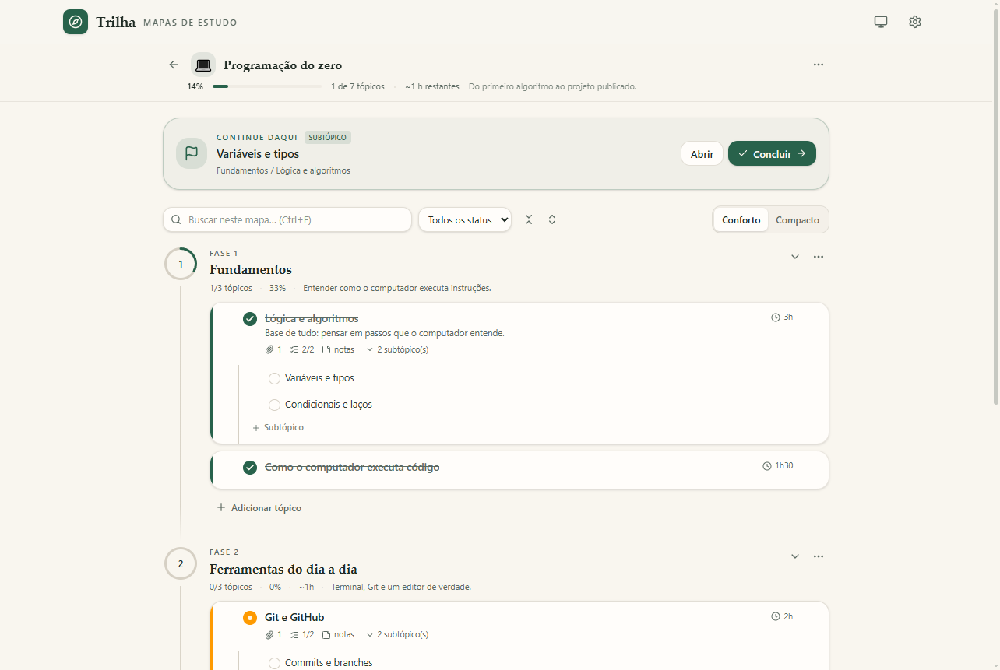
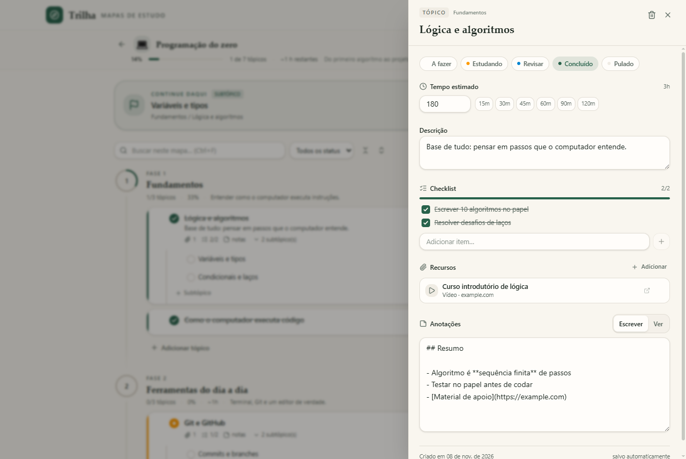

# Trilha

**Mapas de estudo em linha do tempo — do primeiro passo ao objetivo, estação por estação.**

O Trilha é um app de desktop **offline** para montar trilhas de aprendizado sobre qualquer assunto:
você cria as fases, os tópicos e os subtópicos, e acompanha o progresso conforme conclui cada
estação. Sem templates prontos, sem geração automática, sem cronômetro — o mapa é 100% seu.



## Baixar e instalar (Windows)

1. Baixe o instalador na página de releases:
   **[Trilha_1.0.0_Setup.exe](https://github.com/Hyawa/trilha/releases/latest/download/Trilha_1.0.0_Setup.exe)**
2. Execute o arquivo. A instalação é **por usuário** (não pede senha de administrador) e você pode
   escolher a pasta.
3. Abra o **Trilha** pelo atalho criado no menu Iniciar.

> **Aviso do Windows:** o instalador não é assinado digitalmente, então o SmartScreen pode exibir
> “O Windows protegeu o seu PC”. Clique em **Mais informações → Executar assim mesmo**. Isso é
> esperado para builds sem certificado de assinatura de código.

Requisitos: Windows 10 ou 11, 64 bits. Não precisa de conta, internet nem runtime adicional.

## Capturas

| Trilha de um mapa | Detalhes do tópico |
| --- | --- |
|  |  |

## O que dá para fazer

- **Mapas ilimitados.** Cada mapa é um assunto (programação, idiomas, anatomia, música…), com
  ícone, cor, descrição e arquivamento.
- **Timeline vertical em estações.** Fases numeradas com progresso circular, tópicos e subtópicos
  em árvore, arraste para reordenar, recolher/expandir e zoom conforto/compacto.
- **Status por item.** A fazer, estudando, revisar, concluído e pulado — itens pulados saem do
  denominador do progresso.
- **Detalhes do tópico.** Tempo estimado, descrição, checklist, recursos (link, vídeo, livro, PDF)
  e anotações em Markdown com pré-visualização e salvamento automático.
- **“Continue daqui”.** O app aponta sempre o próximo item pendente na ordem da trilha.
- **Busca e filtros.** Busca por título, descrição e anotações (`Ctrl+F`); filtro por status.
- **Exportação.** Markdown e PDF paginado (A4) com capa, progresso e anotações.
- **Backup.** Exportar/importar JSON, com opção de mesclar ou substituir tudo.
- **Tema claro, escuro ou automático.**

## Onde ficam seus dados

`%APPDATA%\Trilha\trilha.db` (SQLite). Em **Configurações → Dados** você vê o caminho exato e pode
abrir a pasta.

- A variável de ambiente `TRILHA_DB_PATH` aponta o banco para outro arquivo (útil em testes).
- O banco usa WAL; feche o app antes de copiar o arquivo manualmente.
- Para levar tudo para outro computador, use **Exportar backup** e depois **Importar backup** lá.
- Nada é enviado para a internet: sem telemetria, sem conta, sem servidor.

## Atalhos

| Atalho | Ação |
| --- | --- |
| `Ctrl+F` | Buscar dentro do mapa aberto |
| `Enter` | Confirmar criação de fase/tópico/subtópico ou item de checklist |
| `Esc` | Sair da edição inline, fechar painel, menu ou diálogo |
| `Ctrl+Shift+I` / `F12` | DevTools (somente em desenvolvimento) |

## Rodando o projeto

```bash
npm install
npm run dev      # app em modo desenvolvimento (hot reload)
```

Gerar o instalador:

```bash
npm run build    # vite build + electron-builder → release/1.0.0/Trilha_1.0.0_Setup.exe
```

Verificações:

```bash
npm run typecheck # TypeScript no renderer e no processo principal
npm test          # testes de lógica e exportação (vitest)
npm run test:e2e  # build + teste de ponta a ponta (Playwright + Electron)
```

## Como o projeto é organizado

```
electron/
  main/        janela, SQLite, repositório, IPC, exportação (MD/PDF) e backup
  preload/     ponte segura (contextBridge) que expõe window.trilha
shared/        tipos de domínio, cálculo de progresso, Markdown e HTML de impressão
src/           React: store zustand, telas, timeline, painel do tópico, UI
tests/         testes unitários (vitest) e E2E (Playwright + Electron)
scripts/       gerador do ícone, captura de telas e smoke test do app empacotado
```

Detalhes: o preload é compilado como ESM real (`dist-electron/preload/index.mjs`) e o renderer só
conversa com o Node por IPC tipado — `contextIsolation` ligado, `nodeIntegration` desligado, CSP no
HTML e navegação externa restrita a `http(s)`/`mailto` via `shell.openExternal`. O banco usa
`better-sqlite3` com migração automática na abertura.

## Licença

MIT.
